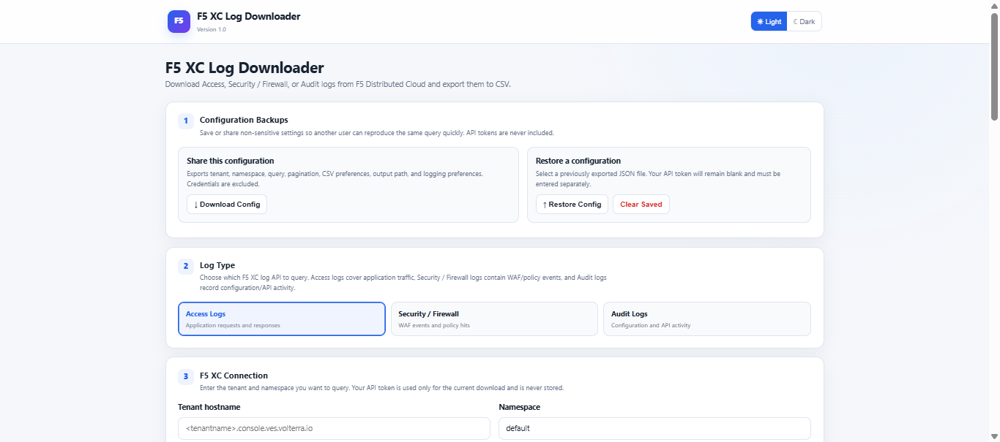
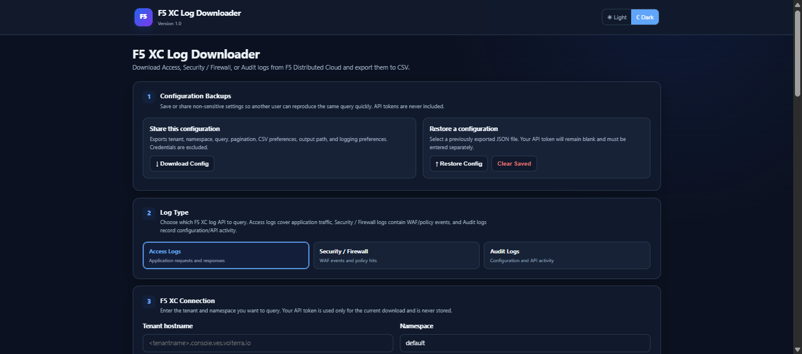
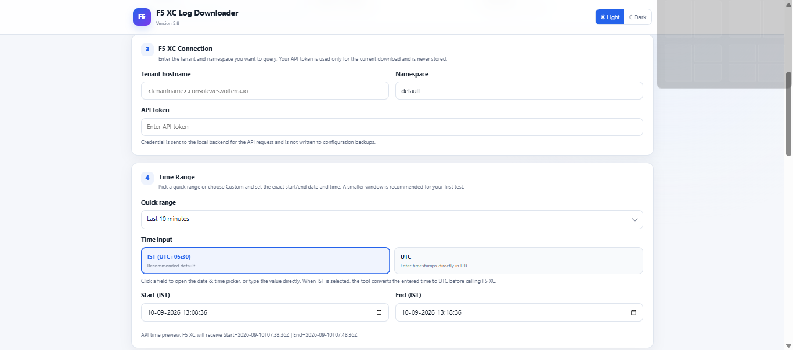
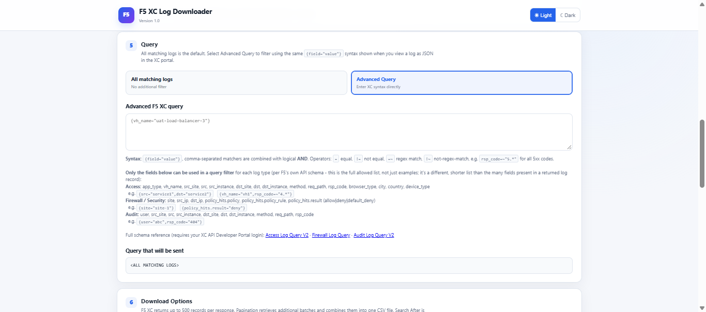
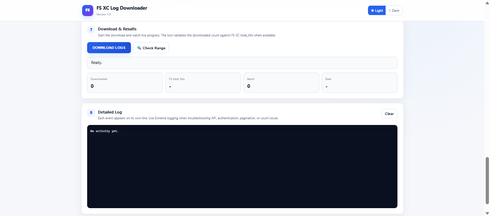

<div align="center">

# F5 XC Log Downloader

**Download Access logs, Audit logs, and WAF Security Events from F5 Distributed Cloud to CSV using a local desktop GUI, instead of scripting the API directly.**


[Quick Start](#quick-start) • [Features](#features) • [Screenshots](#screenshots) • [Security Warnings](#windows-security-warnings) • [Known Limitations](#known-limitations)

</div>

<br>

A self-contained desktop tool for F5 Distributed Cloud (F5 XC) — formerly known as Volterra — that pulls Access logs, Audit logs, or WAF Security Events and exports them to CSV, through a local browser-based UI instead of calling F5's REST API directly.

Runs as a small local web app (Python/Flask backend, single-page UI). Can be run from source, or used as a standalone Windows `.exe` built with PyInstaller.

> **F5 XC Log Downloader is an independent community project and is not an official F5 product, nor is it affiliated with or endorsed by F5.**

<br>

## Why this exists

The F5 XC Console provides an easy way to search and download logs, but a single GUI download is limited to 500 logs. For larger investigations, this can mean repeatedly downloading multiple batches.

F5 Distributed Cloud also exposes this same log data through a REST API (`AccessLogQueryV2`, `AuditLogQueryV2`, and `SecurityEventsQuery` for WAF security events, with their scroll variants), documented at [docs.cloud.f5.com](https://docs.cloud.f5.com/docs-v2/api/log). Working with the API directly means handling authentication, endpoint selection, query syntax, pagination tokens, and JSON responses yourself — reasonable for a script, but overhead if you just want a CSV of last week's WAF events or an audit trail for a review.

This project sits in between: a GUI that picks the right endpoint, handles pagination automatically, and writes a CSV, without requiring API scripting or a Postman collection.

<br>

## Screenshots

<p float="left">
  
  
</p>

<details>
<summary><b>More screenshots</b> — connection &amp; time range, advanced query, download progress</summary>
<br>





</details>

<br>

## Features

| | |
|---|---|
| 🗃️ **Three log sources** | Access logs, Audit logs, and WAF Security Events — each using the F5 XC API it is documented for |
| 🔄 **Automatic pagination** | Pages through large result sets automatically using scroll-token continuation, confirmed to work reliably against F5 XC's live API |
| 🖥️ **System theme** | Follows the Windows light or dark setting, with Light and Dark still available |
| 📖 **Field reference** | Popup listing every filter field with its friendly name, F5 field name and description |
| 🧩 **Filter builder** | Add conditions by choosing a field, Equals or Not equals, and a value. Friendly field names, suggested values from F5's reference, and quick templates. All conditions must match (AND) |
| 🔍 **Advanced filtering** | Type F5 XC's native `{field="value"}` query syntax directly |
| 📤 **CSV / full JSON export** | Plus an always-on activity/debug log for troubleshooting |
| 📊 **Live progress** | Pause / resume / stop, with count validation against F5's own reported `total_hits` |
| 💾 **Config backup/restore** | Export and share non-sensitive settings (API tokens are excluded) as a JSON file |
| 📁 **Native OS folder picker** | A native Windows folder dialog for the output directory |
| ⚡ **"Check Range"** | One-click probe that reports whether F5 XC will accept a given time range/log type, and how many records are available, before running a full download |
| 📦 **Standalone Windows executable** | Can be packaged so recipients don't need Python or any dependencies installed |

<br>

## Quick start

<details open>
<summary><b>Option A — run the prebuilt Windows EXE</b></summary>
<br>

Download `F5XC-Log-Downloader-v2.0.0.exe` from the [latest Release](../../releases/latest), double-click it, then open `http://127.0.0.1:5000` in your browser.
</details>

<details>
<summary><b>Option B — run from source</b></summary>
<br>

```bash
pip install flask requests
python f5xc_log_downloader.py
```
Then open `http://127.0.0.1:5000`.
</details>

<details>
<summary><b>Option C — build your own EXE (Windows)</b></summary>
<br>

```
build_windows_exe.bat
```
This installs Flask/Requests/PyInstaller if needed, builds a onefile EXE, and drops it in `release\F5XC-Log-Downloader-v2.0.0.exe`. The version is part of the file name, so each build is identifiable.
</details>

<br>

## Windows security warnings

The prebuilt Windows executable is currently unsigned because it does not use a paid code-signing certificate.

As a result, Windows SmartScreen or antivirus software may display warnings when you run the executable.

This does not by itself indicate that the application is malicious. However, users should follow their organization's security procedures when evaluating software.

If you do not want to run the prebuilt executable, you can build the application yourself from the source code in this repository (see [Option C](#quick-start) above).

**VirusTotal (v2.0.0 EXE):** 4 of 68 engines flagged the file (Bkav Pro, Microsoft, SecureAge, Skyhigh SWG). [Full report](https://www.virustotal.com/gui/file/a46b2f3c827e7cf159372527e85c9328f05fc3aa7db8d148be0bd991b295c249/detection)


<br>

## How it works

The tool is a single Python file running a local Flask server, with the entire UI (HTML/CSS/JS) served from one template — no separate frontend build step. Log type, time range, and query selections made in the UI are translated into the corresponding F5 XC API request server-side.

<br>

## Credentials & data handling

The application is designed to operate locally.

Your F5 XC API credentials are used by the application to authenticate requests to F5 Distributed Cloud.

API credentials are not sent to the project author or to a separate third-party service by the application.

Configuration backups intentionally exclude API tokens and other sensitive authentication information.

Downloaded logs are saved locally to the output location selected by the user.

The project does not operate a separate server-side service for collecting or storing downloaded log data.

Users are responsible for ensuring that they have appropriate authorization to access and export the F5 XC data retrieved using the application.

<br>

## A real debugging story

*(why this is more than a form wrapper)*

The app first queried WAF security events through the wrong F5 API (`FirewallLogQuery`). That endpoint rejected any `start_time` older than about 8 days, while the XC Console showed up to 30 days. Working through this included ruling out an incorrect initial theory (that the limit was a maximum *range width*). The real cause was the endpoint: F5 TAC confirmed that security events must be queried with the Application Security Monitoring API (`SecurityEventsQuery` / `SecurityEventsScrollQuery`), which is what version 1.1.0 uses. The full investigation is in [CHANGELOG.md](CHANGELOG.md).

The "Check Range" feature remains useful for checking any log type and time range in one click before running a full download.

<br>

## Known limitations

- **Access logs** are retained for 7 days (F5 retention documentation). The app blocks any range whose start is older than 7 days, and warns about any range longer than 7 days.
- **Ranges longer than 30 days are not allowed** for any log type.
- **Audit logs** return data across a 30-day range through this tool in testing.
- **Security Events (WAF)** use the Application Security Monitoring API. The app sends the `SecurityEventsQuery` request to `/api/data/namespaces/{namespace}/app_security/events` and continues with the `scroll` endpoint.
- A `scroll_id` is only valid for approximately 2 minutes between requests, per F5's schema documentation. Pausing a large download for longer than that may require restarting it.
- Pagination uses scroll continuation for all log types. The "Search After" option is kept in the UI for compatibility, but it uses the same scroll mechanism internally, because F5 rejects requests that combine `scroll` and `search_after`.
- The prebuilt Windows executable is unsigned (see [Windows security warnings](#windows-security-warnings) above).

<br>

## License

MIT — see [LICENSE](LICENSE).

<br>

## Contributing

Issues and pull requests are welcome. This started as a focused, single-purpose tool, so contributions that keep it dependency-light and in scope (F5 XC log retrieval and export) are easiest to merge.

<br>

## F5 Distributed Cloud API

This tool is built against F5 Distributed Cloud's published APIs: `AccessLogQueryV2` and `AuditLogQueryV2` (log APIs) and `SecurityEventsQuery` / `SecurityEventsScrollQuery` (Application Security Monitoring API) for WAF security events. Documentation:

[https://docs.cloud.f5.com/docs-v2/api/log](https://docs.cloud.f5.com/docs-v2/api/log) and [https://docs.cloud.f5.com/docs-v2/api/app-security](https://docs.cloud.f5.com/docs-v2/api/app-security)

See [A real debugging story](#a-real-debugging-story) above for one case where observed behavior didn't fully align with the published schema.

<br>

## Disclaimer

**F5 XC Log Downloader is an independent community project and is not an official F5 product, nor is it affiliated with or endorsed by F5.**

F5, F5 Distributed Cloud, and related names are trademarks of F5, Inc. They are used in this project solely to identify the platform and APIs with which the tool is designed to work.

Users are responsible for ensuring that they have appropriate authorization to access and export data using the application and for handling exported log data in accordance with their organization's security and data-handling policies.

<br>

## Download

The latest release, **v2.0.0**, is available on the [Releases](../../releases/latest) page, including the prebuilt Windows executable `F5XC-Log-Downloader-v2.0.0.exe`.

<br>

## Development

This project was built with [Claude](https://www.anthropic.com/claude) (Anthropic) as an AI pair-programmer — code generation, debugging assistance, and documentation drafting were AI-assisted throughout. The requirements, feature direction, and validation were mine: every fix in this repo (including the debugging story above) came from hands-on testing against the F5 XC API and cross-checking behavior against F5's official API documentation, not from taking AI-generated output at face value.

<br>

## Feedback

Bug reports and feature requests are welcome via [GitHub Issues](../../issues).
